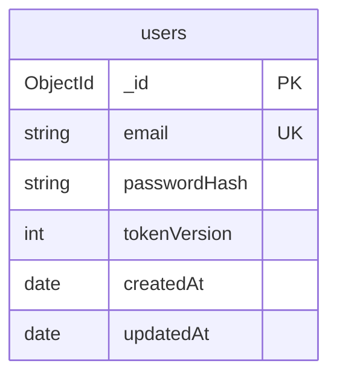
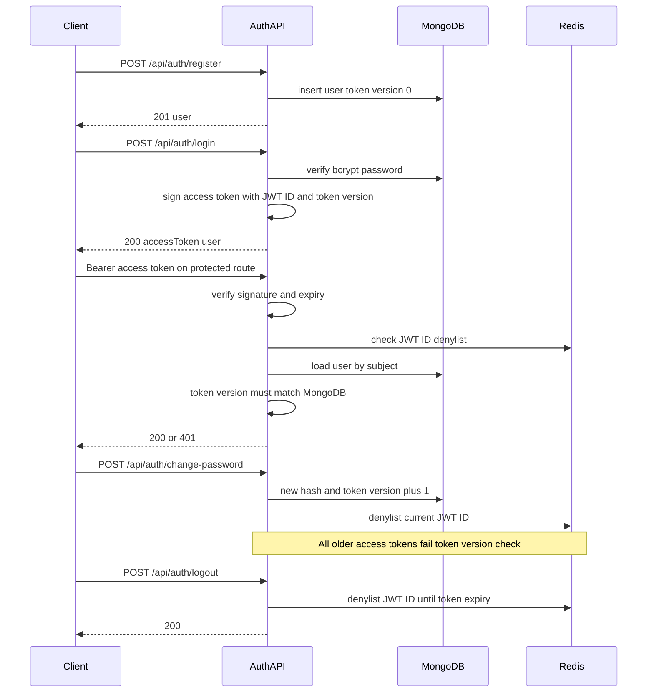
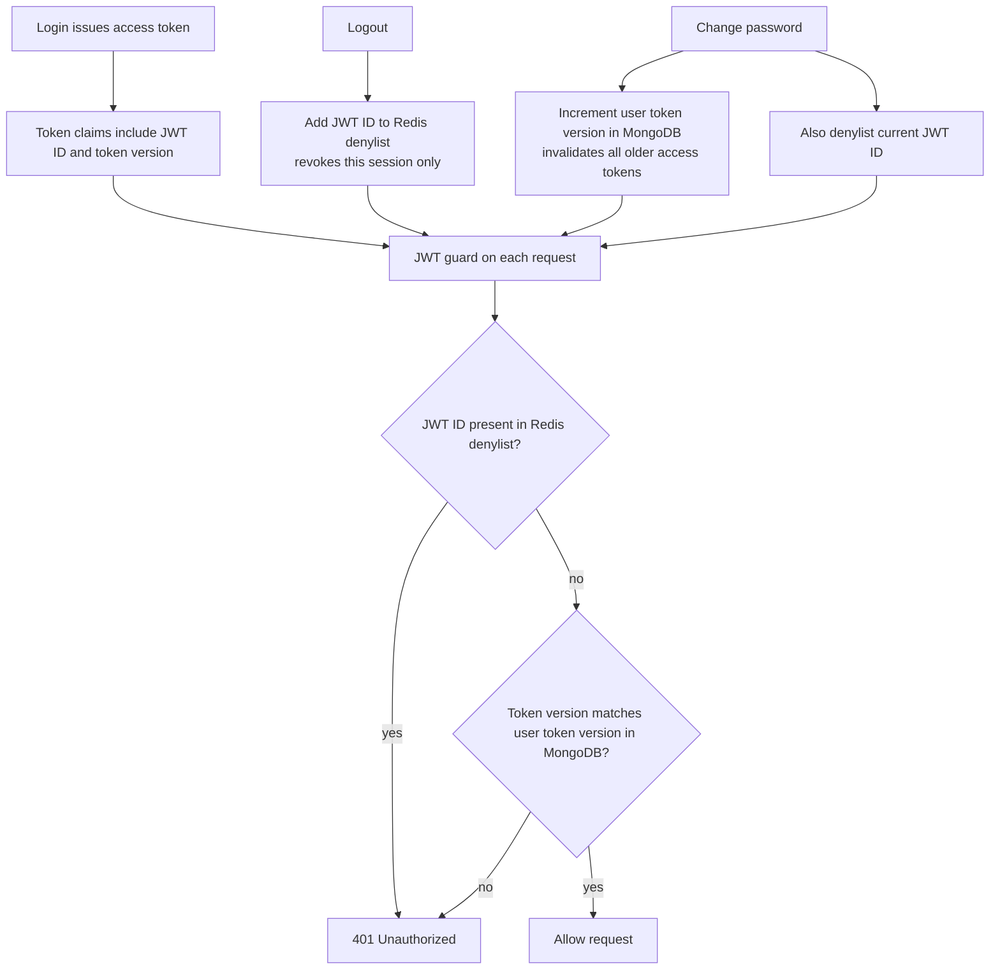
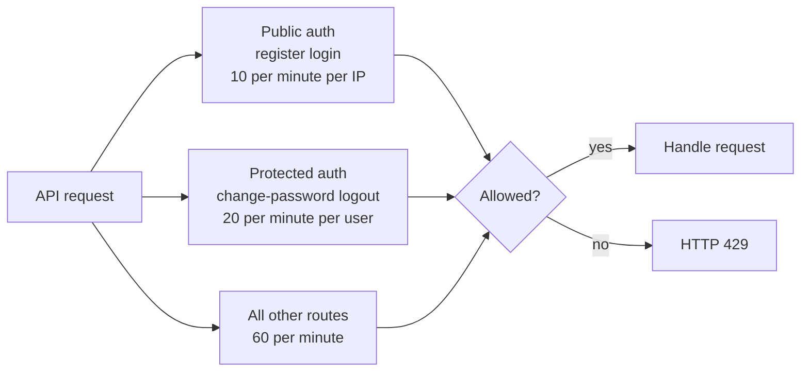
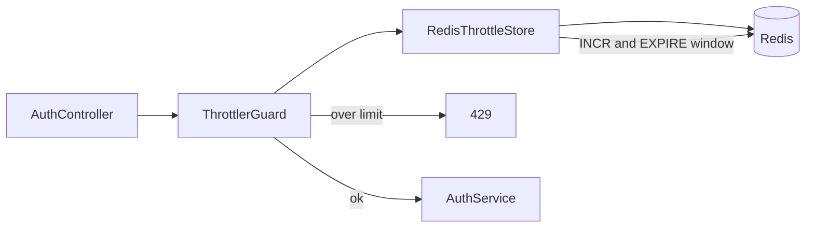
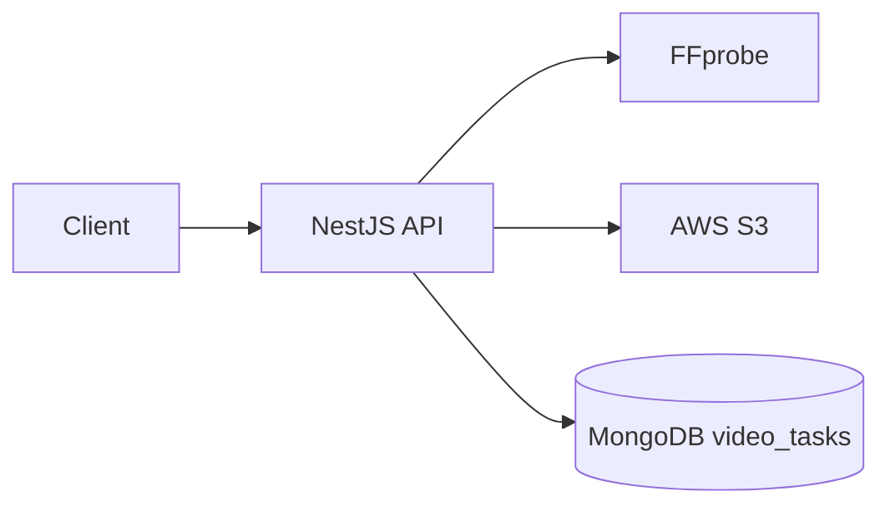

# Video Processing Platform

NestJS backend for authenticated video upload, async FFmpeg processing (BullMQ), AWS S3 storage, and analytics APIs. **API-only** — no web UI.

## Table of contents

- [Status / progress](#status--progress)
- [Tech stack](#tech-stack)
- [Architecture](#architecture)
- [Prerequisites](#prerequisites)
- [Setup & run](#setup--run)
- [Environment variables](#environment-variables)
- [API reference](#api-reference)
- [Security (M1)](#security-m1)
  - [Database design](#database-design)
  - [Authentication flow](#authentication-flow)
  - [JWT ID and token version use-case architecture](#jwt-id-and-token-version-use-case-architecture)
  - [Rate limiting strategy](#rate-limiting-strategy)
  - [Rate limiter](#rate-limiter)
  - [Redis keys for rate limiting](#redis-keys-for-rate-limiting)
- [Upload & storage (M2)](#upload--storage-m2)
  - [Upload architecture](#upload-architecture)
  - [Why AWS S3](#why-aws-s3)
  - [Pros and cons](#pros-and-cons)
  - [CDN notes](#cdn-notes)
  - [`video_tasks` schema](#video_tasks-schema)
- [Queue & status (M3)](#queue--status-m3)
  - [Global concurrency](#global-concurrency)
  - [API vs worker connections](#api-vs-worker-connections)
- [Module changelog](#module-changelog)
- [Project layout](#project-layout)

## Status / progress

| Module | Name | Status |
|--------|------|--------|
| **M0** | Scaffold (health, config, Docker API) | Done |
| **M1** | Auth & security | Done |
| **M2** | Upload & AWS S3 | Done |
| **M3** | Queue & status (+ worker in Compose) | Done |
| M4 | FFmpeg worker | Pending |
| M5 | Email notifications | Pending |
| M6 | Analytics | Pending |
| M7 | Ops, tests, submission polish | Pending |
| M8 | Bonus features | Pending (after core) |

## Tech stack

| Layer | Choice |
|--------|--------|
| API | NestJS + TypeScript |
| Auth | JWT + Passport, bcrypt, Redis JWT ID denylist, token version |
| Database | **Cloud MongoDB** via `MONGODB_URI` (Mongoose) |
| Cache / rate limit / denylist | Redis in Docker Compose |
| Queue | BullMQ + Redis (shared queue; worker concurrency **1**) |
| Storage | **AWS S3** (upload originals in M2) |
| Media | **FFprobe** at upload (ETA); FFmpeg worker in M4 |
| Email | Nodemailer → SMTP (M5) |
| Containers | Compose: **`api` + `redis` + `worker`** |

## Architecture

**M3 (current):** upload → FFprobe → S3 → Mongo `video_tasks` → Redis status cache → BullMQ enqueue. Separate **worker** process runs with **global concurrency 1**; FFmpeg body is still a stub until M4.

```text
Client ──► NestJS API (Compose: api)
              ├── MongoDB (users + video_tasks)
              ├── Redis (denylist + rate limits + task:status cache)
              ├── FFprobe (duration → etaSeconds)
              ├── AWS S3 (original video bytes)
              └── BullMQ producer (enqueue process-video, jobId=taskId)

         NestJS Worker (Compose: worker, concurrency 1)
              └── BullMQ consumer (M3 stub holds jobs; M4 = FFmpeg)
```

## Prerequisites

- **Node.js 24.22.x** — pinned in [`.nvmrc`](.nvmrc) / [`.node-version`](.node-version)
- **npm 11.19.1** — `packageManager` in `package.json` (`corepack enable`)
- Docker + Docker Compose (API + Redis + worker)
- **cloud MongoDB** URI
- **AWS S3** bucket + credentials
- **FFprobe** on PATH for local `npm run start:dev` (Compose API image installs `ffmpeg`)

## Setup & run

1. Copy env and fill secrets:

```bash
cp .env.example .env
# MONGODB_URI, JWT_SECRET
# AWS_REGION, AWS_ACCESS_KEY_ID, AWS_SECRET_ACCESS_KEY, S3_BUCKET
```

2. Allow your machine in the MongoDB network access list; ensure the IAM user can `s3:PutObject` on the bucket.

### Local API + Compose Redis (+ local worker)

```bash
corepack enable
npm install
docker compose up redis -d
npm run start:dev
# other terminal:
npm run start:worker:dev
```

### Full Compose (API + Redis + worker)

```bash
docker compose up --build
```

Health: [http://localhost:3000/health](http://localhost:3000/health)

### Tests

```bash
npm run test
```

## Environment variables

See [`.env.example`](.env.example).

| Variable | Example | Description |
|----------|---------|-------------|
| `NODE_ENV` | `development` | Runtime environment |
| `PORT` | `3000` | HTTP port |
| `MONGODB_URI` | `mongodb+srv://...` | **Your** cloud MongoDB URI (required) |
| `REDIS_URL` | `redis://localhost:6379` | Redis URL (Compose overrides to `redis://redis:6379` for `api`) |
| `JWT_SECRET` | long random string | JWT signing secret |
| `JWT_EXPIRES_IN` | `5h` | Access token lifetime |
| `BCRYPT_COST` | `12` | bcrypt cost factor |
| `THROTTLE_TTL_MS` | `60000` | Rate-limit window |
| `THROTTLE_LIMIT` | `60` | Default requests per window |
| `THROTTLE_AUTH_LIMIT` | `10` | Documented public-auth limit (wired via `@Throttle` on routes) |
| `THROTTLE_USER_LIMIT` | `20` | Documented protected-auth limit |
| `AWS_REGION` | e.g. `ap-south-1` | S3 region |
| `AWS_ACCESS_KEY_ID` | — | IAM access key |
| `AWS_SECRET_ACCESS_KEY` | — | IAM secret |
| `S3_BUCKET` | — | Bucket for originals |
| `S3_ORIGINAL_PREFIX` | `originals/` | Key prefix |
| `MAX_UPLOAD_BYTES` | `524288000` | 500MB cap |
| `FFPROBE_PATH` | `ffprobe` | FFprobe binary |
| `VIDEO_QUEUE_NAME` | `video-processing` | Shared BullMQ queue (all users) |
| `VIDEO_WORKER_CONCURRENCY` | `1` | **System-wide** processing concurrency |
| `TASK_STATUS_CACHE_TTL_SEC` | `86400` | Redis `task:status:*` TTL |

Never commit real credentials. `.env` is gitignored.

## API reference

### `GET /health`

Liveness probe for the API process.

```json
{ "status": "ok" }
```

### Auth

#### `POST /api/auth/register`

Body: `{ "email", "password" }`  
`201` → `{ id, email, createdAt }` (no token; login next). Email is the unique identifier.

#### `POST /api/auth/login`

Body: `{ "email", "password" }`  
`200` → `{ accessToken, tokenType: "Bearer", expiresIn, user }`

#### `POST /api/auth/change-password` (Bearer JWT)

Body: `{ "currentPassword", "newPassword" }`  
Increments **token version** (invalidates all sessions) and denylists current **JWT ID**.

#### `POST /api/auth/logout` (Bearer JWT)

Denylists current **JWT ID** in Redis. `200` → `{ "message": "Logged out" }`

### Videos

#### `POST /api/videos/upload` (Bearer JWT)

- Body: `multipart/form-data` field **`file`**
- Allowlist: MP4, AVI, MOV, WMV, FLV; max **500MB**
- Rate limit: **5 / minute / user**
- `201`:

```json
{
  "taskId": "uuid",
  "status": "queued",
  "s3Key": "originals/userId/taskId/clip.mp4",
  "etaSeconds": 90,
  "progress": 0,
  "metadata": { "durationSec": 125.4 }
}
```

Upload also **enqueues** a BullMQ job (`jobId = taskId`) and writes a Redis status snapshot. Multiple uploads are allowed (rate-limited); **processing** is system-wide concurrency **1** (not per-user). M3 worker stub holds jobs pending; real FFmpeg is M4.

#### `GET /api/videos/tasks` (Bearer JWT)

Query: `limit` (default 20, max 50), `skip` (default 0).  
Returns the current user’s tasks (newest first) as status snapshots.

#### `GET /api/videos/tasks/:taskId` (Bearer JWT)

Owner-only task status (Redis cache with Mongo fallback). `404` if missing or not owned.

#### `GET /api/videos/tasks/:taskId/progress` (Bearer JWT)

```json
{
  "taskId": "uuid",
  "status": "queued",
  "progress": 0,
  "etaSeconds": 30
}
```

Progress stays `0` until M4 updates it during FFmpeg.

---

## Security (M1)

M1 implements registration/login, JWT access tokens (5h), logout via Redis JWT ID denylist, password change with token version bump, and Redis-backed rate limits.

### Database design

`users` collection in cloud MongoDB:



- `email` — unique identifier (lowercase, trimmed)  
- `passwordHash` — bcrypt; never returned in API responses  
- `tokenVersion` — starts at `0`; incremented on password change  

Public user shape: `{ id, email, createdAt }`.

### Authentication flow



### JWT ID and token version use-case architecture

| Claim in JWT | Full name | Role | Use case |
|--------------|-----------|------|----------|
| `jti` | **JWT ID** | Unique id per issued access token | **Logout** — revoke **this** session only via Redis denylist |
| `tv` | **Token version** | Integer on the user document, copied into every new JWT | **Change password** — increment MongoDB token version so **all** older access tokens fail |



1. **Logout** — store this token’s JWT ID in Redis until the access token would expire; other devices keep working.  
2. **Change password** — bump token version + denylist current JWT ID; every older token fails the version check.  
3. **Normal request** — denylist check, then token version match; both must pass.

### Rate limiting strategy

Public auth routes are limited **per client IP**. Authenticated auth routes are limited **per user** (JWT guard runs before the user throttler). Other routes use the default window limit.



| Category | Routes | Scoped by | Limit |
|----------|--------|-----------|--------|
| Public auth | register, login | Client IP | 10 / minute |
| Protected auth | change-password, logout | Authenticated user | 20 / minute |
| Default | other routes | Client IP | 60 / minute |

### Rate limiter



**How the route is wired**

- `@UseGuards(ThrottlerGuard)` (or `UserThrottlerGuard`) — runs the rate-limit check before the handler.
- `@Throttle({ default: { limit, ttl } })` — sets **this route’s** limit/window (overrides the module default from `ThrottlerModule` in `AppModule`).
- `ThrottlerModule.forRootAsync({ storage: RedisThrottlerStorage })` — the guard’s `storage.increment(...)` is our Redis implementation (there is no separate Redis “lookup” API; check = `INCR` then `count > limit`).

### Redis keys for rate limiting

**What is stored (rate limit only — not the JWT or user session)**

| | |
|--|--|
| **Redis key** | `rl:<throttlerName>:<hash>` e.g. `rl:default:4f8fe074e4e8...` |
| **Value** | Integer hit **counter** (`INCR`) |
| **TTL** | Window length (~60s); key auto-deletes when TTL expires (bucket resets) |

**How `<hash>` is generated** (Nest `ThrottlerGuard`, deterministic):

1. **Tracker** — public auth: client IP (`req.ip`); protected auth: `user:<userId>` (fallback IP if no user).
2. **Key material** — `AuthController-<handlerName>-default-<tracker>`  
   Examples: `AuthController-login-default-127.0.0.1`, `AuthController-register-default-127.0.0.1`
3. **Hash** — SHA-256 of that string → the hex suffix in Redis.
4. **Our prefix** — `RedisThrottlerStorage` stores `rl:default:` + that hash.

Same IP + same endpoint → **same Redis key** → shared counter.  
Different endpoints (`login` vs `register`) → **different** handler name in step 2 → **different** keys (separate buckets).

**Other Redis keys (not rate limiting)**

| Key | Value | When |
|-----|--------|------|
| `jwt:deny:<jwt-id>` | `1` | Logout or change-password (TTL = remaining access-token life) |

---

## Upload & storage (M2)

### Upload architecture



- Client uploads multipart to the API with a JWT.
- API validates type/size, probes **duration** with FFprobe, computes `etaSeconds = ceil(durationSec/60)*30`.
- Original bytes go to **S3**; MongoDB stores a minimal `video_tasks` row (`s3Key` at root, `metadata.durationSec` only).
- M3 enqueues BullMQ and caches status; M4 replaces the worker stub with FFmpeg (still concurrency 1).

### Why AWS S3

- Durable object storage without growing disks on API/worker containers.
- Better fit for large video blobs (up to 500MB) than MongoDB or local container FS.
- Same SDK path for originals now and processed outputs/thumbnails later (M4).
- Keeps Compose lean (`api` + `redis`); S3 stays cloud-hosted like MongoDB.

### Pros and cons

| Pros | Cons |
|------|------|
| Scalable blob storage; no disk growth on API containers | Needs AWS credentials, bucket IAM, and network to AWS |
| Clear split: DB = task state, S3 = bytes | Upload + later FFmpeg download add latency/cost |
| Easy key prefixes per user/task | Local/dev needs real (or compatible) S3 access |
| Ready for CDN in front of delivery later | Bad bucket policies can leak or block objects |

### CDN notes

Not implemented in M2 — planned delivery layer after processing:

- S3 remains the **origin**; a CDN (e.g. CloudFront) can cache processed MP4s/thumbnails at edge POPs.
- Repeat viewers hit the CDN instead of S3 (lower latency, lower egress).
- Prefer **signed URLs** or private bucket + CDN origin access — avoid public-read buckets by default.
- **Uploads stay API → S3**; CDN is for **read/delivery**, not ingest.

### `video_tasks` schema

Minimal document:

| Field | Purpose |
|--------|---------|
| `taskId` | Public UUID |
| `userId` | Owner |
| `status` | `queued` \| `processing` \| `completed` \| `failed` \| `cancelled` |
| `s3Key` | S3 object key (root field) |
| `metadata` | `{ durationSec }` only |
| `progress` | `0` until M4 |
| `etaSeconds` | Estimate at submit |
| `failureReason` | Set if enqueue fails (M3) |
| `createdAt` / `updatedAt` | Timestamps |

---

## Queue & status (M3)

### Global concurrency

Processing is **one video at a time for the whole system** (not per-user):

1. Single shared queue `video-processing`
2. Exactly **one** Compose `worker` service (do not scale replicas)
3. BullMQ `{ concurrency: 1 }` (`VIDEO_WORKER_CONCURRENCY`)

Upload/auth rate limits remain per-IP / per-user; they do not control processing concurrency.

### API vs worker connections

- **API** (`node dist/main.js`) — HTTP + BullMQ **producer**
- **Worker** (`node dist/worker.main.js`) — BullMQ **consumer** only
- Both use the same `REDIS_URL`, each with its **own** connections
- BullMQ uses a dedicated connection (`maxRetriesPerRequest: null`); `RedisService` (rate limits / JWT denylist / status cache) stays separate

M3 worker stub logs the job and `moveToDelayed` (~24h) so jobs stay pending without FFmpeg. M4 replaces that stub.

Redis status cache key: `task:status:{taskId}` (TTL from `TASK_STATUS_CACHE_TTL_SEC`).

---

## Module changelog

### M3 — Queue & status

- BullMQ enqueue after upload (`jobId = taskId`); Redis `task:status:*` cache
- `GET /api/videos/tasks`, `GET /api/videos/tasks/:taskId`, `GET .../progress`
- Compose **`worker`** + `start:worker` / `start:worker:dev`; global concurrency **1**
- Processor stub holds jobs for M4 FFmpeg (no transcode yet)

### M2 — Upload & AWS S3

- `POST /api/videos/upload` (JWT, multipart `file`, 500MB, format allowlist)
- FFprobe duration → ETA; S3 `PutObject`; minimal `video_tasks` in MongoDB
- API Docker image installs `ffmpeg` (FFprobe); README architecture / S3 / CDN notes

### M1 — Auth & security

- Cloud MongoDB via `MONGODB_URI`; Compose **`redis`** + **`api`**
- `POST /api/auth/register|login|change-password|logout`
- JWT access tokens (5h) with JWT ID + token version claims
- Redis denylist on logout; token version bump on password change
- Redis-backed rate limits (IP / user)
- Security section diagrams in this README

### M0 — Scaffold

- NestJS + ConfigModule, `GET /health`, Dockerfile, Compose api, living README, Node/npm pins

## Project layout

```text
videoProcessAssignment/
├── src/
│   ├── main.ts
│   ├── worker.main.ts          # worker process entry
│   ├── app.module.ts
│   ├── health/
│   ├── redis/
│   ├── queue/                  # shared BullMQ connection + job types
│   ├── worker/                 # consumer module + processing processor
│   ├── users/
│   ├── auth/
│   ├── s3/                     # AWS S3 client
│   └── videos/                 # upload, status APIs, enqueue, cache, ffprobe
│       └── queue/              # VideoQueueService (producer)
├── Dockerfile                  # includes ffmpeg/ffprobe
├── docker-compose.yml          # api + redis + worker
├── .env.example
├── package.json
└── README.md
```
