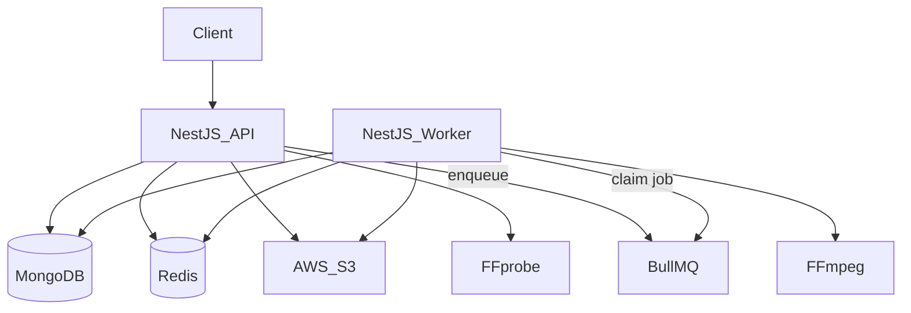
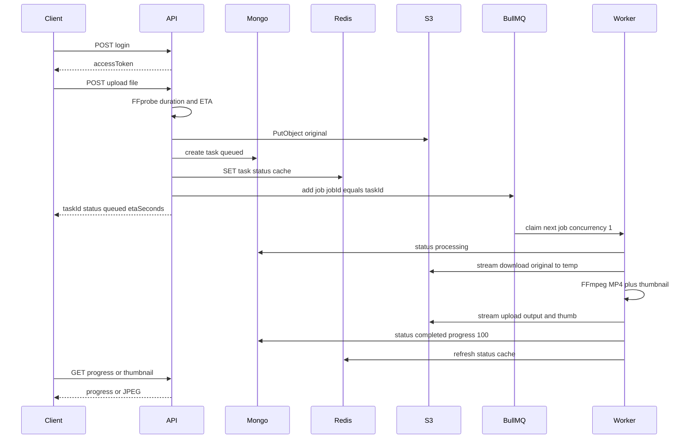
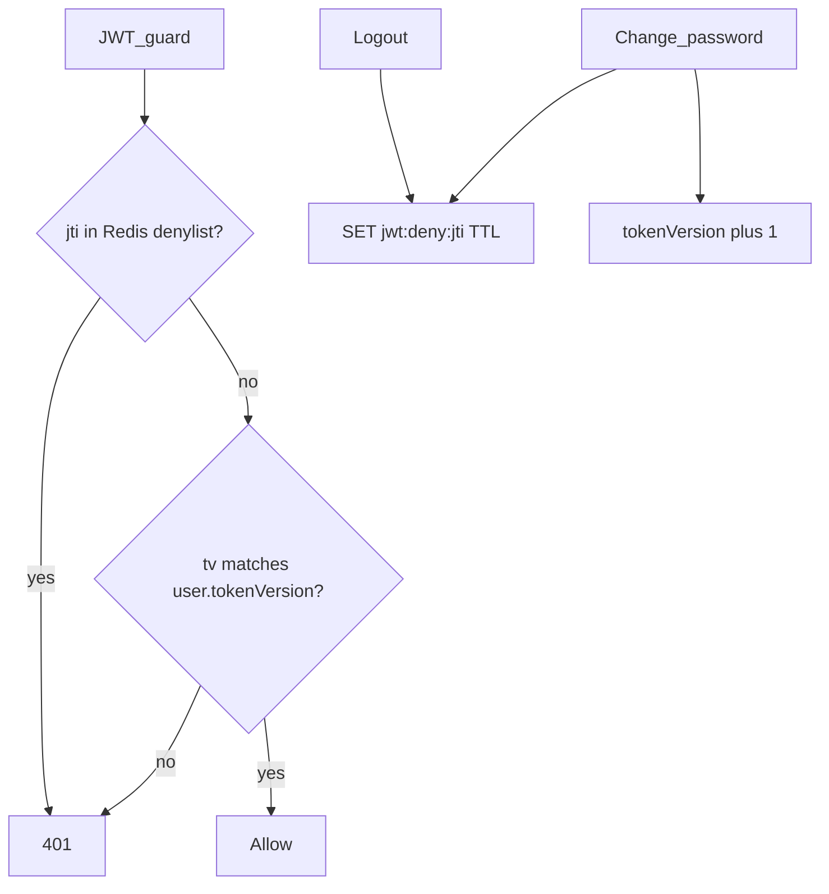
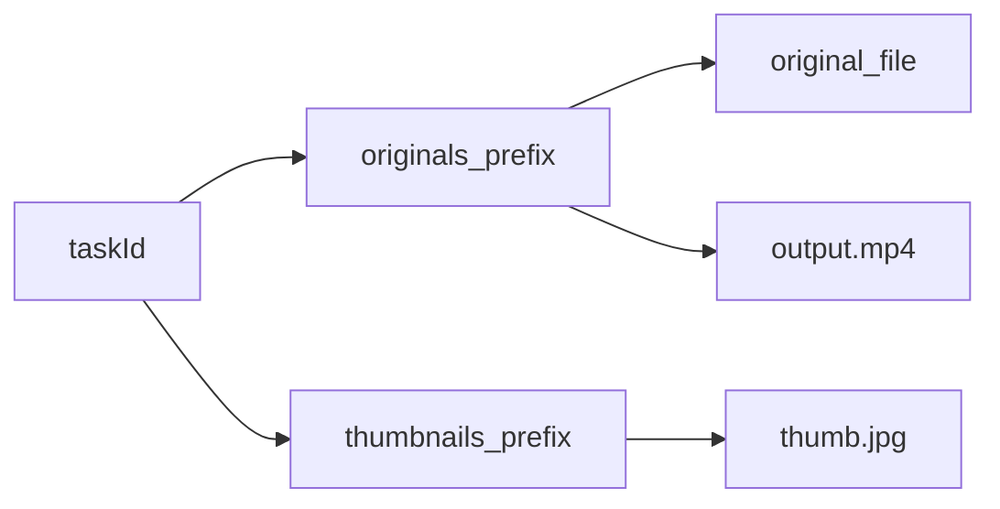
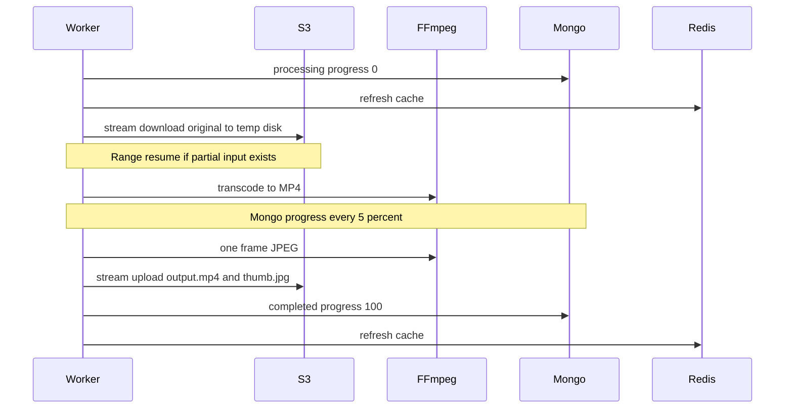

# Video Processing Platform

API-only NestJS backend for authenticated video upload, async FFmpeg processing (one job at a time), AWS S3 storage, and task status APIs.

## Table of contents

- [What it does](#what-it-does)
- [Tech stack](#tech-stack)
- [Architecture](#architecture)
- [End-to-end flow](#end-to-end-flow)
- [Prerequisites](#prerequisites)
- [Setup and run](#setup-and-run)
- [Environment variables](#environment-variables)
- [API reference](#api-reference)
- [Authentication and security](#authentication-and-security)
- [Upload, storage, and processing](#upload-storage-and-processing)
- [Queue and worker](#queue-and-worker)
- [Data model](#data-model)
- [Project layout](#project-layout)

## What it does

| Capability | Behavior |
|------------|----------|
| Auth | Register, login, logout, change password (JWT) |
| Upload | Multipart video → S3 original, duration via FFprobe, ETA |
| Queue | BullMQ job per task; worker concurrency **1** (system-wide) |
| Process | Download → H.264/AAC MP4 + JPEG thumbnail → S3 |
| Status | List/get task, progress polling, thumbnail download |
| Security | bcrypt, JWT ID denylist, token version, Redis rate limits |

**Not built yet:** email notifications, analytics APIs.

## Tech stack

| Layer | Choice |
|--------|--------|
| Runtime | Node.js **24.22.x**, npm **11.19.1** |
| API | NestJS + TypeScript (ESM) |
| DB | Cloud MongoDB (Mongoose) |
| Redis | Rate limits, JWT denylist, task status cache, BullMQ |
| Queue | BullMQ (`video-processing`, concurrency 1) |
| Storage | AWS S3 |
| Media | FFprobe (upload ETA), FFmpeg (worker) |
| Deploy | Docker Compose: `api` + `redis` + `worker` |

## Architecture



- **API process** (`node dist/main.js`) — HTTP, upload, enqueue, status reads.
- **Worker process** (`node dist/worker.main.js`) — BullMQ consumer; FFmpeg + S3 + status writes.
- Same `REDIS_URL` and Mongo URI; separate process connections. BullMQ uses its own Redis client (`maxRetriesPerRequest: null`), separate from app `RedisService`.

## End-to-end flow



## Prerequisites

- Node.js 24.22.x and npm 11.19.1 (`corepack enable`)
- Docker + Docker Compose
- Cloud MongoDB URI (allow your IP)
- AWS S3 bucket + IAM rights for `PutObject` / `GetObject` / `HeadObject` / `DeleteObject`
- For local (non-Compose) API/worker: `ffprobe` and `ffmpeg` on `PATH`

## Setup and run

```bash
cp .env.example .env
# Fill MONGODB_URI, JWT_SECRET, AWS_* , S3_BUCKET
```

**Compose (recommended):**

```bash
docker compose up --build
```

Health: [http://localhost:3000/health](http://localhost:3000/health)

**Local API + Redis + worker:**

```bash
docker compose up redis -d
npm install
npm run start:dev
# other terminal
npm run start:worker:dev
```

**Tests:**

```bash
npm run test
```

## Environment variables

See [`.env.example`](.env.example). Do not commit real secrets.

| Variable | Purpose |
|----------|---------|
| `PORT` | API port (default `3000`) |
| `MONGODB_URI` | Cloud MongoDB connection string |
| `REDIS_URL` | Redis (`localhost` locally; Compose sets `redis://redis:6379`) |
| `JWT_SECRET` / `JWT_EXPIRES_IN` | Access token signing (default lifetime `5h`) |
| `BCRYPT_COST` | Password hash cost |
| `THROTTLE_*` | Rate-limit window and limits |
| `AWS_REGION` / `AWS_ACCESS_KEY_ID` / `AWS_SECRET_ACCESS_KEY` | S3 credentials |
| `S3_BUCKET` | Bucket name |
| `S3_ORIGINAL_PREFIX` | Original + processed MP4 prefix (`originals/`) |
| `S3_THUMBNAIL_PREFIX` | Thumbnail prefix (`thumbnails/`) |
| `MAX_UPLOAD_BYTES` | Max upload size (default 500MB) |
| `FFPROBE_PATH` / `FFMPEG_PATH` | Media binaries |
| `VIDEO_QUEUE_NAME` | BullMQ queue name |
| `VIDEO_WORKER_CONCURRENCY` | Must stay `1` for one-at-a-time processing |
| `TASK_STATUS_CACHE_TTL_SEC` | Status cache TTL (default 24h) |

## API reference

Base URL: `http://localhost:3000`

### Health

`GET /health` → `{ "status": "ok" }`

### Auth

| Method | Path | Auth | Notes |
|--------|------|------|--------|
| `POST` | `/api/auth/register` | No | Body `{ email, password }` → user (no token) |
| `POST` | `/api/auth/login` | No | → `{ accessToken, tokenType, expiresIn, user }` |
| `POST` | `/api/auth/change-password` | Bearer | `{ currentPassword, newPassword }` — bumps token version |
| `POST` | `/api/auth/logout` | Bearer | Denylists this JWT ID |

### Videos

| Method | Path | Auth | Notes |
|--------|------|------|--------|
| `POST` | `/api/videos/upload` | Bearer | Multipart field **`file`**; MP4/AVI/MOV/WMV/FLV; max 500MB; 5/min/user |
| `GET` | `/api/videos/tasks` | Bearer | `limit` (default 20, max 50), `skip` |
| `GET` | `/api/videos/tasks/:taskId` | Bearer | Owner-only status snapshot |
| `GET` | `/api/videos/tasks/:taskId/progress` | Bearer | `{ taskId, status, progress, etaSeconds }` |
| `GET` | `/api/videos/tasks/:taskId/thumbnail` | Bearer | `image/jpeg` when completed |

**Upload response example:**

```json
{
  "taskId": "uuid",
  "status": "queued",
  "s3Key": "originals/userId/taskId/clip.mp4",
  "etaSeconds": 90,
  "progress": 0,
  "metadata": { "durationSec": 125.4 }
}
```

**ETA:** `etaSeconds = ceil(durationSec / 60) * 30` (estimated processing seconds, not video length).

### Quick test (PowerShell)

```powershell
curl -X POST http://localhost:3000/api/auth/login `
  -H "Content-Type: application/json" `
  -d "{\"email\":\"you@example.com\",\"password\":\"password123\"}"

curl -X POST http://localhost:3000/api/videos/upload `
  -H "Authorization: Bearer YOUR_TOKEN" `
  -F "file=@D:\path\to\video.mp4"

curl http://localhost:3000/api/videos/tasks/TASK_ID/progress `
  -H "Authorization: Bearer YOUR_TOKEN"

curl http://localhost:3000/api/videos/tasks/TASK_ID/thumbnail `
  -H "Authorization: Bearer YOUR_TOKEN" `
  -o thumb.jpg
```

## Authentication and security

### Users

MongoDB `users`: unique `email`, `passwordHash` (bcrypt, never returned), `tokenVersion` (default `0`).

### JWT access tokens

Payload includes `sub` (user id), `email`, **`jti`** (JWT ID), **`tv`** (token version), `exp`.



| Action | Effect |
|--------|--------|
| Logout | Denylist this `jti` until token expiry — other sessions keep working |
| Change password | Increment `tokenVersion` + denylist current `jti` — all older tokens fail |

### Rate limits (Redis)

| Routes | Scope | Limit |
|--------|--------|--------|
| register, login | Client IP | 10 / minute |
| change-password, logout | User id | 20 / minute |
| video upload | User id | 5 / minute |
| Default | Client IP | 60 / minute |

Counters live under `rl:default:<hash>` (TTL = window). Denylist keys: `jwt:deny:<jti>`.

## Upload, storage, and processing

### Upload path

1. Validate format/size  
2. FFprobe duration → ETA  
3. `PutObject` original to S3  
4. Create `video_tasks` (`queued`)  
5. Cache status in Redis  
6. Enqueue BullMQ job (`jobId = taskId`)

### S3 layout

```text
originals/{userId}/{taskId}/{originalFilename}
originals/{userId}/{taskId}/output.mp4
thumbnails/{userId}/{taskId}/thumb.jpg
```



S3 holds bytes; Mongo holds task state. A CDN can sit in front of processed objects later; uploads always go API → S3.

### Worker pipeline



- Downloads/uploads stream to/from temp disk (no full-file Node buffers for media).
- Original download is **resumable**: a partial temp `input` is kept across attempts; the next try uses S3 `Range` and appends.
- On transient failure (S3 / FFmpeg), BullMQ retries up to **3** attempts with exponential backoff (~5s → 10s → 20s). Status stays `processing` until the last attempt.
- On **final** failure: `status: failed`, `failureReason` set; orphaned processed objects (`output.mp4`, `thumb.jpg`) are deleted; temp work dir is wiped. The original upload remains. There is no manual retry API — upload again for a new task.

## Queue and worker

- **One queue** for all users: `video-processing`
- **One worker** container/process; **concurrency 1** → one video processed at a time globally (uploads can still arrive in parallel)
- API **produces** jobs; worker **consumes** them from Redis (FIFO waiting list)
- `jobId = taskId` avoids duplicate jobs for the same task


### Redis: status cache vs BullMQ

| Key pattern | Purpose |
|-------------|---------|
| `task:status:{taskId}` | JSON snapshot for fast status/progress GETs (TTL configurable) |
| `bull:video-processing:*` | BullMQ waiting/active/completed job data |

Mongo remains the source of truth for tasks. Cache miss → read Mongo → refill cache. Ownership is always checked for status APIs.

## Data model

### `users`

| Field | Role |
|--------|------|
| `email` | Unique login id |
| `passwordHash` | bcrypt |
| `tokenVersion` | Invalidates old JWTs on password change |

### `video_tasks`

| Field | Role |
|--------|------|
| `taskId` | Public UUID |
| `userId` | Owner |
| `status` | `queued` \| `processing` \| `completed` \| `failed` \| `cancelled` |
| `s3Key` | Original object key |
| `outputKey` / `thumbnailKey` | Processed artifacts |
| `metadata.durationSec` | From FFprobe at upload |
| `progress` | 0–100 |
| `etaSeconds` | Estimate at submit |
| `failureReason` | Optional |
| `startedAt` / `completedAt` | Processing timing |

## Project layout

```text
src/
  main.ts                 # API entry
  worker.main.ts          # Worker entry
  app.module.ts
  auth/                   # JWT auth, guards, rate-limit by user
  users/
  videos/                 # upload, status APIs, enqueue, FFprobe, status cache
  queue/                  # shared BullMQ connection
  worker/                 # consumer + VideoProcessingService (FFmpeg)
  s3/
  redis/
  health/
docker-compose.yml        # api, redis, worker
Dockerfile                # Node image + ffmpeg/ffprobe
.env.example
```
