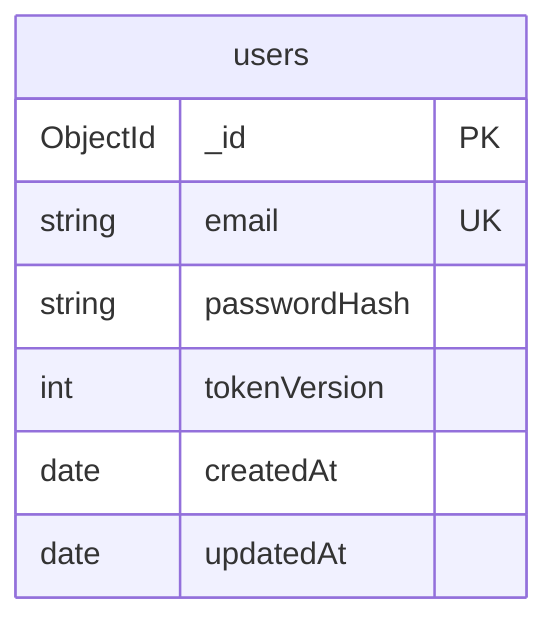
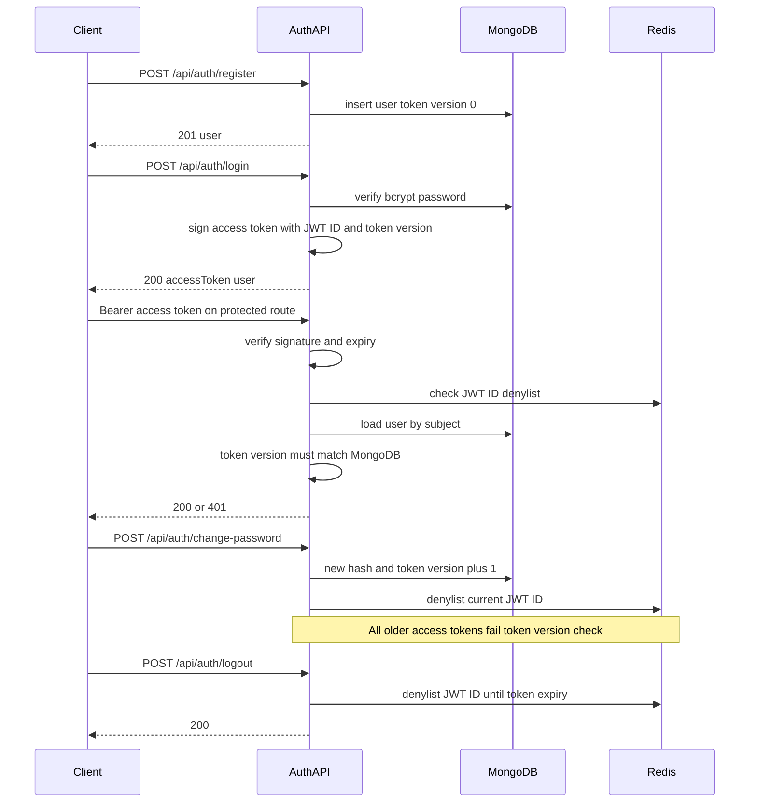
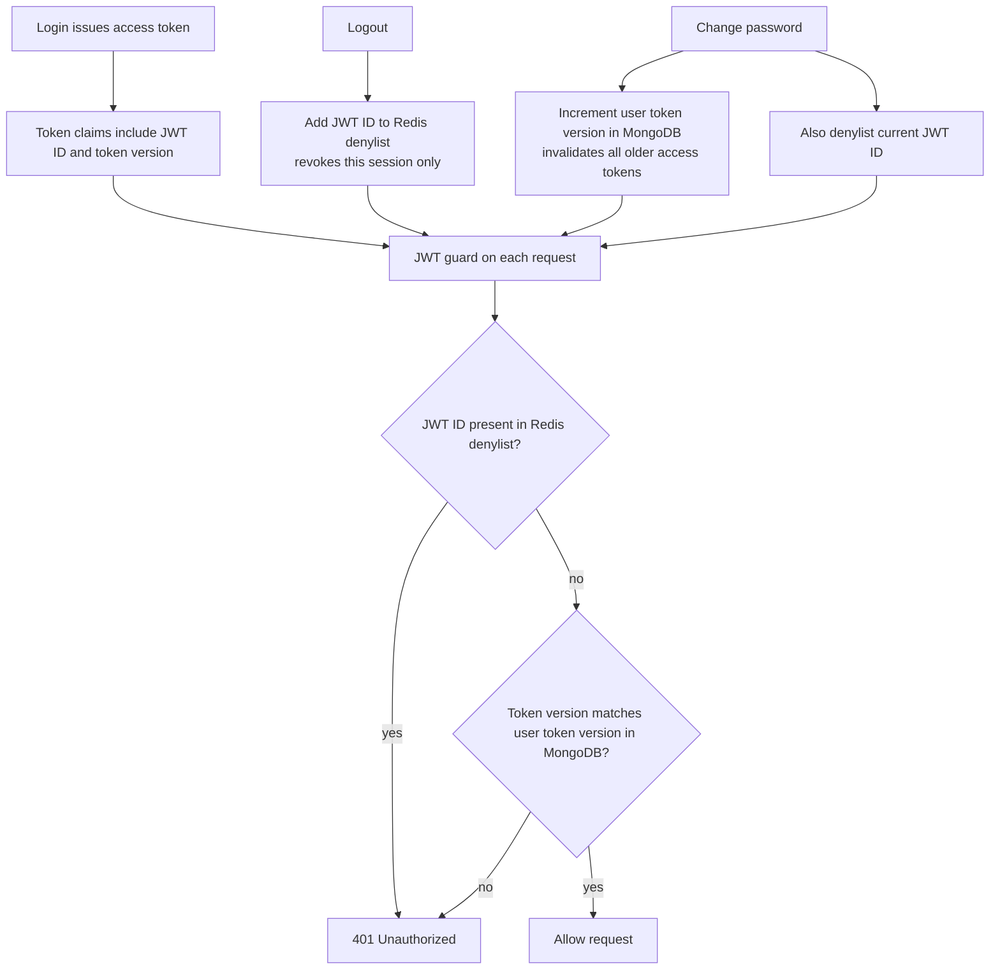
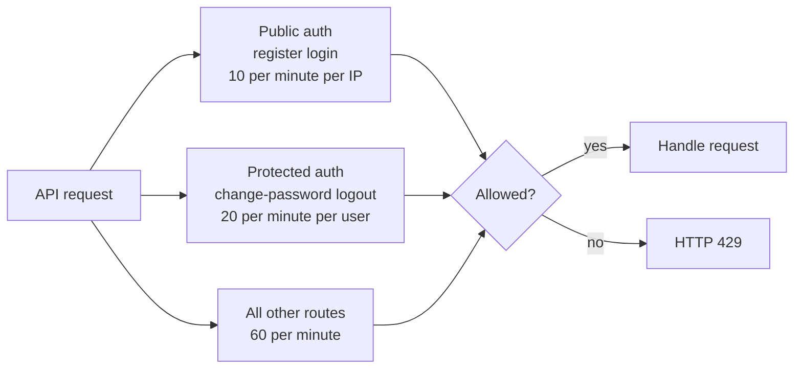
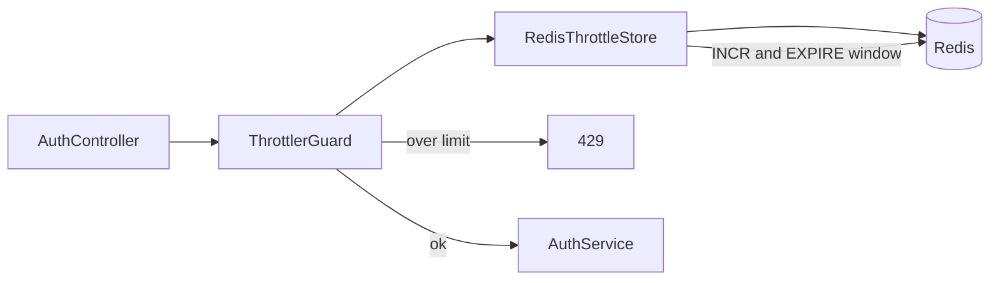

# Video Processing Platform

NestJS backend for authenticated video upload, async FFmpeg processing (BullMQ), AWS S3 storage, and analytics APIs. **API-only** — no web UI.

## Table of contents

- [Status / progress](#status--progress)
- [Tech stack](#tech-stack)
- [Architecture](#architecture)
- [Prerequisites](#prerequisites)
- [Setup & run](#setup--run)
- [Environment variables](#environment-variables)
- [API reference](#api-reference)
- [Security (M1)](#security-m1)
  - [Database design](#database-design)
  - [Authentication flow](#authentication-flow)
  - [JWT ID and token version use-case architecture](#jwt-id-and-token-version-use-case-architecture)
  - [Rate limiting strategy](#rate-limiting-strategy)
  - [Rate limiter](#rate-limiter)
- [Module changelog](#module-changelog)
- [Project layout](#project-layout)

## Status / progress

| Module | Name | Status |
|--------|------|--------|
| **M0** | Scaffold (health, config, Docker API) | Done |
| **M1** | Auth & security | Done |
| M2 | Upload & AWS S3 | Pending |
| M3 | Queue & status (+ worker in Compose) | Pending |
| M4 | FFmpeg worker | Pending |
| M5 | Email notifications | Pending |
| M6 | Analytics | Pending |
| M7 | Ops, tests, submission polish | Pending |
| M8 | Bonus features | Pending (after core) |

## Tech stack

| Layer | Choice |
|--------|--------|
| API | NestJS + TypeScript |
| Auth | JWT + Passport, bcrypt, Redis JWT ID denylist, token version |
| Database | **Cloud MongoDB** via `MONGODB_URI` (Mongoose) |
| Cache / rate limit / denylist | Redis in Docker Compose |
| Queue | BullMQ + Redis (M3+) |
| Storage | AWS S3 (M2) |
| Media | FFmpeg / FFprobe (M2/M4) |
| Email | Nodemailer → SMTP (M5) |
| Containers | Compose: **`api` + `redis`** (M1); worker in M3 |

## Architecture

**M1 (current):** NestJS API authenticates users against cloud MongoDB; Redis holds JWT ID denylist entries and rate-limit counters.

```text
Client ──► NestJS API (Compose: api)
              ├── MongoDB (cloud via MONGODB_URI)
              └── Redis (Compose: redis)
```

## Prerequisites

- **Node.js 24.22.x** — pinned in [`.nvmrc`](.nvmrc) / [`.node-version`](.node-version)
- **npm 11.19.1** — `packageManager` in `package.json` (`corepack enable`)
- Docker + Docker Compose (API + Redis)
- A **cloud MongoDB** connection string (Atlas or similar)

## Setup & run

1. Copy env and set your cloud MongoDB URI:

```bash
cp .env.example .env
# Edit .env → MONGODB_URI=your cloud connection string
# Edit .env → JWT_SECRET=a-long-random-secret
```

2. Allow your machine (or `0.0.0.0/0` for demos) in the MongoDB network access list.

### Local API + Compose Redis

```bash
corepack enable
npm install
docker compose up redis -d
npm run start:dev
```

### Full Compose (API + Redis)

```bash
docker compose up --build
```

Health: [http://localhost:3000/health](http://localhost:3000/health)

### Tests

```bash
npm run test
```

## Environment variables

See [`.env.example`](.env.example).

| Variable | Example | Description |
|----------|---------|-------------|
| `NODE_ENV` | `development` | Runtime environment |
| `PORT` | `3000` | HTTP port |
| `MONGODB_URI` | `mongodb+srv://...` | **Your** cloud MongoDB URI (required) |
| `REDIS_URL` | `redis://localhost:6379` | Redis URL (Compose overrides to `redis://redis:6379` for `api`) |
| `JWT_SECRET` | long random string | JWT signing secret |
| `JWT_EXPIRES_IN` | `5h` | Access token lifetime |
| `BCRYPT_COST` | `12` | bcrypt cost factor |
| `THROTTLE_TTL_MS` | `60000` | Rate-limit window |
| `THROTTLE_LIMIT` | `60` | Default requests per window |
| `THROTTLE_AUTH_LIMIT` | `10` | Documented public-auth limit (wired via `@Throttle` on routes) |
| `THROTTLE_USER_LIMIT` | `20` | Documented protected-auth limit |

Never commit real MongoDB credentials. `.env` is gitignored.

## API reference

### `GET /health`

Liveness probe for the API process.

```json
{ "status": "ok" }
```

### Auth

#### `POST /api/auth/register`

Body: `{ "email", "password" }`  
`201` → `{ id, email, createdAt }` (no token; login next). Email is the unique identifier.

#### `POST /api/auth/login`

Body: `{ "email", "password" }`  
`200` → `{ accessToken, tokenType: "Bearer", expiresIn, user }`

#### `POST /api/auth/change-password` (Bearer JWT)

Body: `{ "currentPassword", "newPassword" }`  
Increments **token version** (invalidates all sessions) and denylists current **JWT ID**.

#### `POST /api/auth/logout` (Bearer JWT)

Denylists current **JWT ID** in Redis. `200` → `{ "message": "Logged out" }`

---

## Security (M1)

M1 implements registration/login, JWT access tokens (5h), logout via Redis JWT ID denylist, password change with token version bump, and Redis-backed rate limits.

### Database design

`users` collection in cloud MongoDB:



- `email` — unique identifier (lowercase, trimmed)  
- `passwordHash` — bcrypt; never returned in API responses  
- `tokenVersion` — starts at `0`; incremented on password change  

Public user shape: `{ id, email, createdAt }`.

### Authentication flow



### JWT ID and token version use-case architecture

| Claim in JWT | Full name | Role | Use case |
|--------------|-----------|------|----------|
| `jti` | **JWT ID** | Unique id per issued access token | **Logout** — revoke **this** session only via Redis denylist |
| `tv` | **Token version** | Integer on the user document, copied into every new JWT | **Change password** — increment MongoDB token version so **all** older access tokens fail |



1. **Logout** — store this token’s JWT ID in Redis until the access token would expire; other devices keep working.  
2. **Change password** — bump token version + denylist current JWT ID; every older token fails the version check.  
3. **Normal request** — denylist check, then token version match; both must pass.

### Rate limiting strategy

Public auth routes are limited **per client IP**. Authenticated auth routes are limited **per user** (JWT guard runs before the user throttler). Other routes use the default window limit.



| Category | Routes | Scoped by | Limit |
|----------|--------|-----------|--------|
| Public auth | register, login | Client IP | 10 / minute |
| Protected auth | change-password, logout | Authenticated user | 20 / minute |
| Default | other routes | Client IP | 60 / minute |

### Rate limiter



Counters use Redis keys prefixed with `rl:`. JWT ID denylist keys use `jwt:deny:` on the same Redis instance.

---

## Module changelog

### M1 — Auth & security

- Cloud MongoDB via `MONGODB_URI`; Compose **`redis`** + **`api`**
- `POST /api/auth/register|login|change-password|logout`
- JWT access tokens (5h) with JWT ID + token version claims
- Redis denylist on logout; token version bump on password change
- Redis-backed rate limits (IP / user)
- Security section diagrams in this README

### M0 — Scaffold

- NestJS + ConfigModule, `GET /health`, Dockerfile, Compose api, living README, Node/npm pins

## Project layout

```text
videoProcessAssignment/
├── src/
│   ├── main.ts
│   ├── app.module.ts
│   ├── health/
│   ├── redis/
│   ├── users/
│   └── auth/
├── Dockerfile
├── docker-compose.yml          # api + redis
├── .env.example
├── package.json
└── README.md
```
